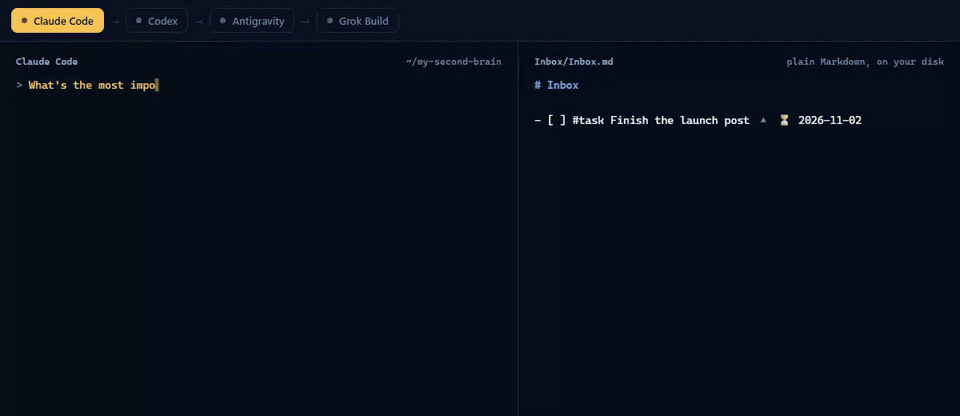
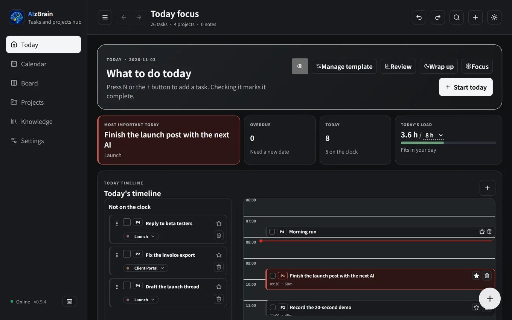
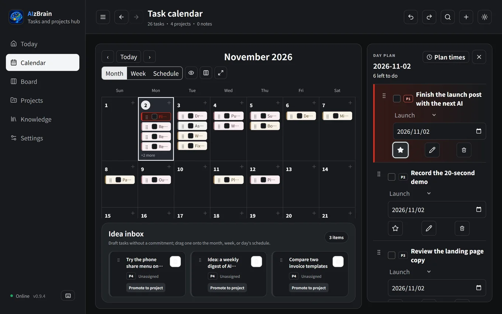
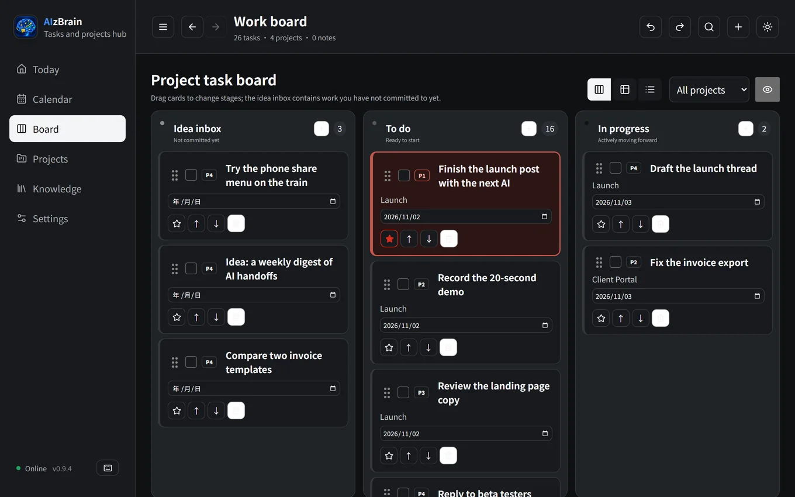

<div align="center">


# AIzBrain

**Models change. Your workflow doesn't.**

The free, local second brain that every AI model shares, including the next best one.

[Website](https://aizbrain.com) · [Download](https://github.com/GsirGinRay/aizbrain/releases/latest) · [How the handoff works](docs/ai-handoff.md) · [繁體中文](README.zh-TW.md)

[](https://github.com/GsirGinRay/aizbrain/releases/latest)
[](LICENSE)




</div>

Claude runs out halfway through? Open another AI in the same folder and ask where things stand. Your tasks, context and AI work logs live in ordinary Markdown on your computer, so nothing is trapped in a chat window.

It's also a task manager built around one habit: focus on one most important task a day. And because the files are on your own disk, there's no server to wait for, and the app works offline.

## Try it in 30 seconds

```bash
npx aizbrain init my-second-brain
cd my-second-brain
claude          # or codex, grok, opencode, ...
```

Ask "What's the most important task today?", then switch tools and ask "Where did we leave off?". No account, and nothing is uploaded.

Prefer an app? [Download for Windows or Mac](https://github.com/GsirGinRay/aizbrain/releases/latest) to get the calendar, board, notifications and phone inbox on the same files.

## How the handoff works

1. **Rules in one place.** `.ai/INSTRUCTIONS.md` holds the rules. `CLAUDE.md`, `AGENTS.md`, `GEMINI.md` and `QWEN.md` point every tool at it.
2. **Context at the start.** A session-start hook hands the AI today's most important task and the latest handoffs from `.ai/INDEX.md`.
3. **A log at the end.** Each AI adds a work log under the task: done, result, next. If it changes files and forgets, the stop hook reminds it once.

```markdown
- [ ] #task Finish the launch post [[Launch]] ⏳ 2026-11-02

  ### AI work log 2026-11-02 21:14 (Claude Code)
  - Done: drafted the post
  - Result: Knowledge/Launch post.md
  - Next: tighten the intro
```

| Tool | How it connects |
| --- | --- |
| Claude Code, Grok Build, Codex, Antigravity | Hooks and rule files |
| OpenCode, Cursor, Windsurf, VS Code, Zed, Warp, goose, Amp, Roo Code, Kilo Code, Junie, Augment Code, Qwen Code | Rule files (`AGENTS.md`, `QWEN.md`) |
| Claude Desktop and other MCP clients | `npx aizbrain mcp` |

Any model works if its tool can read your folder. A web chat can't read files on your computer, so ChatGPT on the web only joins through a client that can. The model also needs to read files on its own; very small local models may not look. See [docs/ai-handoff.md](docs/ai-handoff.md) for the details.

## The app



| | |
| --- | --- |
|  |  |

*Real screens with made-up data.*

**What to do today**
- Today page: today's single most important task, a timeline and unscheduled tasks
- Load warning when today holds more hours than you have
- Focus mode: one task at a time with a timer
- Wrap-up: move what is left to tomorrow in one click and see what you finished
- Waiting list: follow up on work you handed off
- Review: tasks finished per week and the projects that moved most, up to 12 weeks back

**Planning**
- Month and week calendar with drag to reschedule; box-select several tasks to move or delete them together
- Task board, also as a table or a list
- Projects as cards, a table or by status, with their tasks, notes and attachments
- Knowledge: prompts and reference notes, with prompt import and export
- Search across fields: `+` for OR, `&` or a space for AND

**Capture**
- Quick add (`N`): type "Pay the phone bill tomorrow at 3pm" and the date and time are recognized
- Repeating tasks: daily, on weekdays, on a day of the month or a custom interval
- Checklists inside a task, with progress on the card
- System notifications before a task starts and a daily summary
- Phone inbox: pair once, then send tasks from your phone or its share menu, end-to-end encrypted

**Also**
- Traditional Chinese and English, light and dark themes
- Undo and redo (`Ctrl+Z` / `Ctrl+Shift+Z`)

## Your data is Markdown

Every action writes straight to the folder you chose; there is no separate database.

- Obsidian, VS Code or any editor can open the same files. Repeat rules and similar tokens follow Obsidian Tasks.
- Every write is preceded by a verified backup and done atomically, so a crash never leaves a half-written file.
- To read the same files on a phone, keep the folder in OneDrive, Dropbox, Google Drive or Obsidian Sync.
- Folder names follow the language the vault was created in, and switching the interface language later does not rename them.

## What's free

Everything that runs on your computer is free and MIT licensed: the desktop app, the CLI, hooks, the MCP server and the phone inbox.

One feature is paid, because it depends on a hosted service: **today's list on your phone** (view, tick off and reschedule tasks). It comes with membership in the author's community on [Skool](https://www.skool.com), a paid community platform. The code is public like the rest.

## Privacy

- Your Markdown is never uploaded; all reading and writing happens in the folder you chose.
- The app goes online only to check for updates and, after you pair a phone, for the phone features.
- Phone tasks are encrypted on the phone and only your computer can open them. The relay at `inbox.aizbrain.com` keeps the unreadable data until your computer picks it up, then deletes it (14 days at most).
- If you turn on the paid phone list, your computer also sends an encrypted snapshot of your upcoming tasks, which the relay can't read. See [docs/inbox-relay.md](docs/inbox-relay.md).
- An AI tool can read what is in the folder when you open it there, and that tool's own terms apply.

## Install notes

**Windows.** Download `aizbrain_x.y.z_x64-setup.exe` from the [latest release](https://github.com/GsirGinRay/aizbrain/releases/latest) and run it. SmartScreen warns about new software without a paid signing certificate: click **More info**, then **Run anyway**. You only see this on the first install.

**Mac.** Download `aizbrain_x.y.z_universal.dmg` (macOS 11 or later) and drag it into Applications. Open it once, then go to **System Settings → Privacy & Security** and click **Open Anyway**. After an update macOS may ask about its Keychain item; choose **Always Allow**.

**Updates.** The app checks at launch and every 6 hours, asks before installing, and verifies each update against the public key built into it. Updates never touch your Markdown folder.

**Hooks without the CLI.** The desktop app can install hooks too, once "AI handoff" is built from Settings:

```
<App>\second-brain-workspace.exe --aizbrain-hook install claude <your folder>
```

Replace `claude` with `codex` or `antigravity`, and `install` with `uninstall` to remove them.

## Contributing

Issues and pull requests are welcome, in English or Chinese. See [CONTRIBUTING.md](CONTRIBUTING.md), the [good first issues](https://github.com/GsirGinRay/aizbrain/labels/good%20first%20issue) and the [changelog](CHANGELOG.md).

```bash
git clone https://github.com/GsirGinRay/aizbrain.git
cd aizbrain
npm install
npm run desktop:dev   # development mode
npm test              # TypeScript unit, integration and DOM tests
npm run rust:test     # Rust tests
npm run build         # type check and web build
```

The desktop app needs Node.js 20+, Rust stable and the Tauri 2 prerequisites (on Windows: WebView2 and Visual Studio Build Tools with the C++ workload).

| Folder | Contents |
| --- | --- |
| `apps/desktop` | Desktop app: Tauri 2 (Rust) with React and TypeScript |
| `apps/mobile-capture` | Phone web app (PWA) |
| `apps/website` | aizbrain.com |
| `packages/brain-core` | Markdown parsing, task rules, encryption format |
| `packages/brain-ui` | Calendar, search and other shared logic |
| `packages/cli` | The `aizbrain` command: init, hooks and MCP server |
| `services/inbox-relay` | Phone inbox relay server (Rust) |
| `examples/sample-vault` | Sample data (all made up) |

See [docs/architecture.md](docs/architecture.md) for the architecture.

## License

MIT
