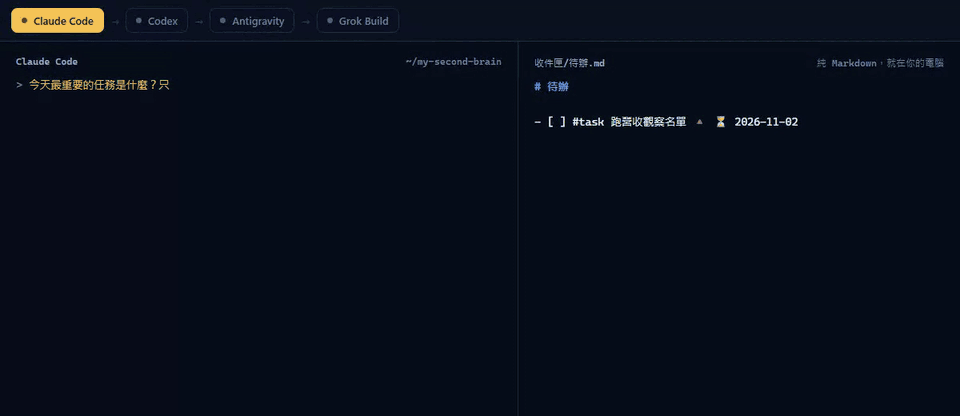
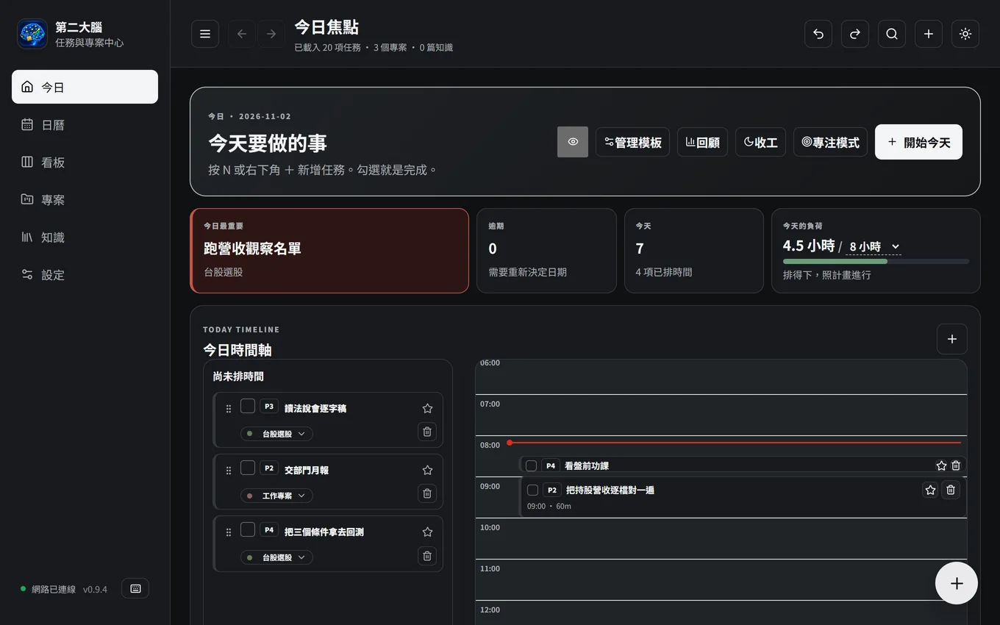
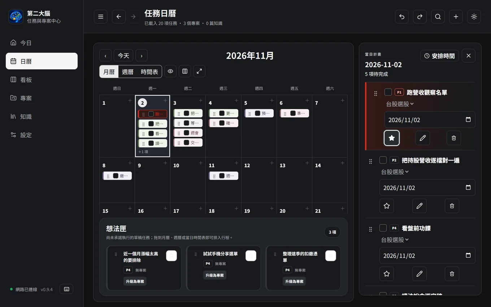
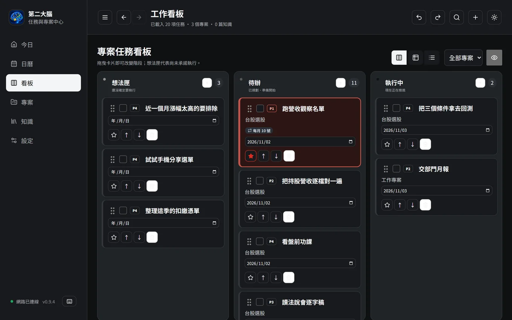

<div align="center">


# 第二大腦 AIzBrain

**AI 模型可以換，工作流程不能換。**

免費、開源，存在你自己電腦裡。今天用哪一家、下一個最強的模型是誰，都共用同一個第二大腦。

[官網](https://aizbrain.com/zh-TW/) · [下載](https://github.com/GsirGinRay/aizbrain/releases/latest) · [交接怎麼運作](docs/ai-write-back-plan.md) · [English](README.md)

[](https://github.com/GsirGinRay/aizbrain/releases/latest)
[](LICENSE)




</div>

Claude 做到一半額度用完？在同一個資料夾打開另一家 AI，問一句「做到哪了」就接得上。任務、來龍去脈和 AI 工作紀錄都是你電腦裡的一般 Markdown 檔，不會只留在某個聊天視窗裡。

它也是一套任務管理工具，核心習慣是一天只專注一件最重要的事。檔案就在你自己的電腦裡，不用等別人的伺服器，沒網路也能用。

## 開始使用

**一般使用者：** 到[最新版本頁面](https://github.com/GsirGinRay/aizbrain/releases/latest)下載安裝，第一次打開時選一個資料夾。要讓 AI 接得上，到「設定 → 建立知識架構 → 新建架構模板」勾選「AI 委任架構」。

**會用命令列的話，30 秒就能試：**

```bash
npx aizbrain init my-second-brain
cd my-second-brain
claude          # 也可以用 codex、grok、opencode……
```

問一句「今天最重要的任務是什麼？」，再換一家工具問「做到哪了？」。不用註冊，也不會上傳任何東西。

## 交接怎麼運作

1. **規則放在同一處。** `.ai/INSTRUCTIONS.md` 寫規則，`CLAUDE.md`、`AGENTS.md`、`GEMINI.md`、`QWEN.md` 把每家工具都帶到這裡。
2. **開始時有脈絡。** 對話一開始，hook 會把今天最重要的任務和最近的交接（來自 `.ai/INDEX.md`）交給 AI。
3. **結束時留紀錄。** 每家 AI 做完都在任務下面寫工作紀錄：做了什麼、結果在哪、下一步。改了檔案卻忘了寫，hook 會提醒一次。

```markdown
- [ ] #task 跑營收觀察名單 [[台股選股]] ⏳ 2026-11-10

  ### AI 工作紀錄 2026-11-10 21:14（Claude Code）
  - 做了什麼：完成第一輪篩選
  - 結果在哪：知識/觀察名單.md
  - 下一步：做成表格
```

| 工具 | 接法 |
| --- | --- |
| Claude Code、Grok Build、Codex、Antigravity | hook 加規則檔 |
| OpenCode、Cursor、Windsurf、VS Code、Zed、Warp、goose、Amp、Roo Code、Kilo Code、Junie、Augment Code、Qwen Code | 規則檔（`AGENTS.md`、`QWEN.md`） |
| Claude Desktop 等支援 MCP 的工具 | `npx aizbrain mcp` |

只要工具讀得到你的資料夾，換哪個模型都可以。網頁聊天看不到你電腦裡的檔案，所以網頁版 ChatGPT 要透過讀得到檔案的工具才能接上；模型也要能讀檔案；如果它沒有自己去讀，跟它說「先讀 `AGENTS.md`」就好。

## App 畫面



| | |
| --- | --- |
|  |  |

*都是 App 的真實畫面，資料是虛構的示範內容。*

**今天要做什麼**
- 今日頁：今天最重要的一件事、時間軸和尚未排時間的任務
- 今天排的時數超過可用時間時會提醒
- 專注模式：一次只看一件事，附計時器
- 收工：一鍵把沒做完的移到明天，再看看完成了哪些
- 等待清單：追蹤交辦出去的工作
- 回顧：每週完成幾件、哪個專案進展最多，最多往回看 12 週

**規劃**
- 月曆和週曆拖曳改期；可以框選多個任務一起移動或刪除
- 任務看板，也可以切換成表格或清單
- 專案可用卡片、表格或狀態檢視，任務、筆記和附件都在一起
- 知識：提示詞和參考筆記，提示詞可匯入匯出
- 跨欄位搜尋：`+` 是或、`&` 或空白是且

**記錄**
- 快速新增（`N`）：打「明天下午三點繳電話費」，日期和時間自動辨識
- 重複任務：每天、平日、每月幾號或自訂間隔
- 任務內的勾選清單，卡片上顯示進度
- 任務開始前的系統通知和每日摘要
- 手機收件匣：配對一次，就能從手機或分享選單送任務，端對端加密

**其他**
- 繁體中文和英文介面，淺色和深色主題
- 復原和重做（`Ctrl+Z` / `Ctrl+Shift+Z`）

## 你的資料就是 Markdown

每個動作都直接寫進你選的資料夾，沒有另外的資料庫。

- Obsidian、VS Code 或任何編輯器都能打開同一批檔案；重複規則等標記沿用 Obsidian Tasks 的格式。
- 每次寫入前都先驗證備份，再一次寫入完成，就算當機也不會留下寫一半的檔案。
- 想在手機讀同一批檔案，可以把資料夾放進 OneDrive、Dropbox、Google Drive 或 Obsidian Sync。
- 資料夾名稱跟著建立時的語言，之後切換介面語言不會改名。

## 哪些免費

在你電腦上跑的全部免費，採 MIT 授權：桌面 App、命令列工具、hook、MCP 伺服器和手機收件匣。

只有一項收費，因為要靠託管服務運作：**手機今天清單**（在手機上看今天的任務、打勾、改期），這是「AI投資學院+」付費會員的權益。程式碼一樣全部公開。

## 隱私

- 你的 Markdown 不會上傳，所有讀寫都發生在你選的資料夾。
- App 只有在檢查更新，以及配對手機後使用手機功能時才會連線。
- 手機送出的任務在手機上就加密，只有你的電腦解得開。中繼伺服器 `inbox.aizbrain.com` 只保管讀不懂的資料，電腦取走後就刪除，最多保存 14 天。
- 如果開啟付費的手機清單，電腦也會傳送加密過的近期任務快照，中繼伺服器讀不到內容。詳見 [docs/inbox-relay.md](docs/inbox-relay.md)。
- 在資料夾裡打開 AI 工具時，該工具讀得到資料夾內容，並適用該工具自己的條款。

## 安裝說明

**Windows。** 從[最新版本頁面](https://github.com/GsirGinRay/aizbrain/releases/latest)下載 `aizbrain_x.y.z_x64-setup.exe` 並執行。沒有付費程式碼簽章的新軟體，SmartScreen 會跳出警告：按**其他資訊**，再按**仍要執行**，只有第一次安裝會看到。

**Mac。** 下載 `aizbrain_x.y.z_universal.dmg`（macOS 11 以上），拖進「應用程式」。先打開一次，再到**系統設定 → 隱私權與安全性**按**強制打開**。更新後 macOS 可能詢問鑰匙圈項目，選**永遠允許**。

**更新。** App 啟動時和每 6 小時檢查一次，安裝前會先問你，並用內建的公開金鑰驗證。更新不會動到你的 Markdown 資料夾。

**不用命令列工具也能裝 hook。** 在設定建好「AI 委任架構」後：

```
<App>\second-brain-workspace.exe --aizbrain-hook install claude <你的資料夾>
```

把 `claude` 換成 `codex` 或 `antigravity`；把 `install` 換成 `uninstall` 就能移除。

## 參與開發

歡迎用中文或英文回報問題、送 Pull Request。請看 [CONTRIBUTING.md](CONTRIBUTING.md)、[適合新手的 issue](https://github.com/GsirGinRay/aizbrain/labels/good%20first%20issue) 和[更新紀錄](CHANGELOG.md)。

```bash
git clone https://github.com/GsirGinRay/aizbrain.git
cd aizbrain
npm install
npm run desktop:dev   # 開發模式
npm test              # TypeScript 單元、整合與 DOM 測試
npm run rust:test     # Rust 測試
npm run build         # 型別檢查與網頁建置
```

桌面 App 需要 Node.js 20+、Rust stable 和 Tauri 2 的開發環境（Windows：WebView2、含 C++ 工作負載的 Visual Studio Build Tools）。

| 資料夾 | 內容 |
| --- | --- |
| `apps/desktop` | 桌面 App：Tauri 2（Rust）、React、TypeScript |
| `apps/mobile-capture` | 手機網頁 App（PWA） |
| `apps/website` | aizbrain.com |
| `packages/brain-core` | Markdown 解析、任務規則、加密格式 |
| `packages/brain-ui` | 日曆、搜尋等共用邏輯 |
| `packages/cli` | `aizbrain` 指令：初始化、hook、MCP 伺服器 |
| `services/inbox-relay` | 手機收件匣中繼伺服器（Rust） |
| `examples/sample-vault` | 範例資料（全部虛構） |

架構說明請看 [docs/architecture.md](docs/architecture.md)。

## 授權

MIT
